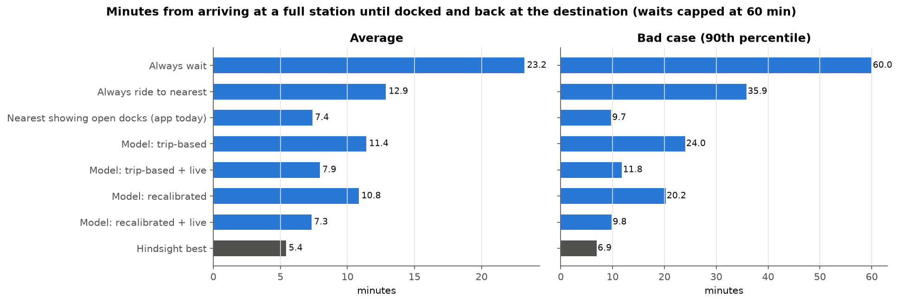

# Citi Bike 2024: Demand Patterns and a Wait-or-Ride-On Decision

Two questions about NYC Citi Bike, using all 44.2 million trips from 2024:

1. **Where, when and in what weather do people ride?** [`Final Notebook.ipynb`](Final%20Notebook.ipynb)
2. **If you arrive at a full station, should you wait for a dock or ride to a nearby one?** [`Decision_model.ipynb`](Decision_model.ipynb)

---

## Part 1: Demand patterns

**What I did.** Counted arrivals and departures at every station in 30-minute windows, joined hourly Central Park weather (converted from UTC to New York time) and US holidays, matched stations to NYC neighborhoods, and summarized demand by station, neighborhood, month, temperature and rain.

**What I found**
- Ridership climbs from about 2 million rides a month in January–February to a plateau from June through October, peaking at 5.1 million in October.
- Activity is concentrated in Manhattan: 49 of the 50 stations with the most traffic are there. Traffic at a single station varies a lot across half-hours: at the busiest station, the standard deviation over the year's half-hours is about as large as the average.
- Rides rise with temperature. Rainy half-hours are too few to compare cell by cell in a heatmap (no cell with over 1 mm of rain has more than 44 half-hours behind it), so I rely on Part 2's regression, which holds station, time of day and season fixed: any rain is associated with at least 22% fewer departures (more in heavier rain), and temperatures below 35°F with about 45% fewer than 65–75°F.
- On the evening of a Knicks game at Madison Square Garden (Nov 8, 2024), arrivals at nearby stations were within the range of other Friday evenings.


Station maps count *rides in + out* (each ride counts at both its start and end station); citywide figures count each ride once. An interactive version of the station map is in [`station_demand_map.html`](station_demand_map.html) (download and open in a browser).

---

## Part 2: Wait or ride on?

You ride up to your destination station to return a bike and every dock is taken. Should you wait for someone to take a bike out, or ride to a nearby station and walk back?

**What I did**
- Estimated each station's departure rate (its usual pattern for that half-hour and day type, times a citywide weather and season multiplier from a Poisson regression) from trips on days 1–21 of each month.
- Turned the rate into the chance that a dock opens within *w* minutes, and an expected wait.
- Checked those probabilities against 2-minute station status snapshots at moments when stations were really full, on the held-out days 22–end, and fitted a small three-parameter correction on days 15–21.
- Replayed 47,894 real full-station moments from the held-out days. Each rule chose between staying and the 5 nearest stations within 500 m, and each choice was scored by what actually happened.

**Results**, per rider. Total minutes = ride to the chosen station + wait there + walk back, with **the wait capped at 60 minutes**. The last column is the share of riders still waiting after 60 minutes at the station they chose (not counting the ride there).

| Rule | Uses live data | Mean | 90th percentile | Still waiting after 60 min at chosen station |
|---|---|---|---|---|
| Always wait | no | 23.2 | 60.0 | 19.0% |
| Always ride to the nearest station (stay if none within 500 m) | no | 12.9 | 35.9 | 6.4% |
| Model, trip-based | no | 11.4 | 24.0 | 4.0% |
| **Model, recalibrated** | no | **10.8** | **20.2** | 3.5% |
| Nearest station showing open docks (app-style rule) | yes | 7.4 | 9.7 | 1.0% |
| Model, trip-based + live | yes | 7.9 | 11.8 | 1.8% |
| **Model, recalibrated + live** | yes | **7.3** | **9.8** | 1.0% |
| Hindsight best (knows the future) | | 5.4 | 6.9 | 0.3% |



**What it shows**
- **Without live data**, the recalibrated model does better than the simple rules tested: 10.8 minutes on average vs. 12.9 for always riding to the nearest station, and 20.2 vs. 35.9 at the 90th percentile.
- **With live data**, the app-style rule and the recalibrated model tie (7.4 vs. 7.3 minutes). The uncalibrated model does worse than the simple rule (7.9 minutes). It overestimates how quickly docks open at full stations (16.8% predicted vs. 14.4% actual within 10 minutes) and waits for 19% of riders, against 4% for the recalibrated model.
- Hindsight averages 5.4 minutes, about 2 minutes better than the best rules. In hindsight, waiting was the best choice for about a quarter of riders.

**Limitations**
- The replay includes only moments when every candidate station (the full station and its up to 5 nearest neighbors within 500 m) was in service and reporting for the whole hour (48k of 60k sampled), so it describes those conditions.
- Waits are capped at 60 minutes and measured on a 2-minute grid. Riders are assumed not to affect each other, travel times are approximate, and the models use the weather observed over the next hour as a stand-in for a forecast.
- These are point estimates from one year, without confidence intervals; differences of a few tenths of a minute are ties.

Details, diagnostics and the full list of limitations are in the notebook.

---

## How to Run
1. Create an environment (Python 3.10+, tested on 3.13):
   ```bash
   python3 -m venv .venv
   source .venv/bin/activate
   pip install -r requirements.txt
   ```
2. Download the 2024 monthly trip files from [Citi Bike System Data](https://citibikenyc.com/system-data) and unzip them into `data/trips/`.
3. Run the notebooks top to bottom. `Decision_model.ipynb` downloads the station status file (4.2 GB, public, no login) into `data/status/` on first run and builds a smaller cache. Each notebook loads a full year of trips and needs several GB of RAM; each took about 10 minutes on a laptop.

## Data and Credits
- Trip data: [Citi Bike System Data](https://citibikenyc.com/system-data), used under the Citi Bike data license agreement.
- Station status snapshots: [rosenthal/citi-bike-stations](https://www.kaggle.com/datasets/rosenthal/citi-bike-stations) on Kaggle (CC BY 4.0).
- Weather: [Meteostat](https://meteostat.net) (CC BY-NC 4.0).
- Neighborhood boundaries: NYC Neighborhood Tabulation Areas (`Neighborhood_NTA.geojson`).
