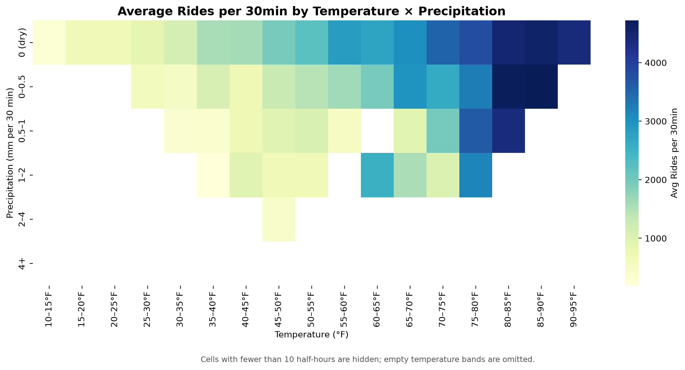

# Citi Bike 2024: Demand Patterns and a Wait-or-Ride Decision

This project explores demand across 44.2 million NYC Citi Bike trips in 2024, then tests a simple model for deciding whether to wait at a full station or ride to another one.

- Part 1, demand patterns: [`Final Notebook.ipynb`](Final%20Notebook.ipynb)
- Part 2, the wait-or-ride decision: [`Decision_model.ipynb`](Decision_model.ipynb)

## Part 1: Demand patterns

### Method
Arrivals and departures were counted at each station in 30-minute windows and joined with hourly Central Park weather (converted from UTC to New York time) and US holidays. Stations were matched to NYC neighborhoods.

### Findings
- Monthly rides rose from about 2 million in January and February to a plateau from June through October, peaking at 5.1 million in October.
- 49 of the 50 busiest stations are in Manhattan. Traffic at individual stations varies a lot: at the busiest station, the standard deviation across half-hours is about as large as the mean.
- Rides increase with temperature. Heavy rain was too rare in 2024 to compare reliably in the heatmap (no cell with more than 1 mm of rain covers more than 44 half-hours). In the Part 2 regression, which controls for station, time of day and season, any rain is associated with at least 22% fewer departures, and temperatures below 35°F with about 45% fewer than 65–75°F.
- Arrivals near Madison Square Garden before the Nov 8 Knicks game were within the range of other Friday evenings.




The station map counts rides starting or ending at each station; the citywide charts count each ride once. An interactive map is in [`station_demand_map.html`](station_demand_map.html) (open it in a browser).

## Part 2: Wait or ride to another station?

When a rider arrives to return a bike and every dock is taken, they can wait for a dock to open or ride to a nearby station and walk back.

### Method
- Each station's departure rate was estimated from trips on days 1–21 of each month: its usual pattern for that half-hour and day type, times a citywide weather and season multiplier from a Poisson regression. Each departure frees a dock, so the rate gives the probability that a dock opens within a given time.
- These probabilities were checked on days 22–end against 2-minute station status snapshots taken while stations were full. A three-parameter correction was fitted on days 15–21.
- 47,894 full-station moments from days 22–end were replayed. At each one, a rule chose between waiting and riding to one of the 5 nearest stations within 500 m, and the choice was scored using what actually happened.

### Results
Total minutes per rider: ride to the chosen station, wait there (capped at 60 minutes), and walk back. The last column is the share of riders still waiting after 60 minutes at the chosen station.

| Rule | Live data | Mean | 90th percentile | Still waiting after 60 min |
|---|---|---|---|---|
| Always wait | no | 23.2 | 60.0 | 19.0% |
| Always ride to the nearest station (if one is within 500 m) | no | 12.9 | 35.9 | 6.4% |
| Model, trip-based | no | 11.4 | 24.0 | 4.0% |
| Model, recalibrated | no | 10.8 | 20.2 | 3.5% |
| Nearest station showing open docks | yes | 7.4 | 9.7 | 1.0% |
| Model, trip-based + live | yes | 7.9 | 11.8 | 1.8% |
| Model, recalibrated + live | yes | 7.3 | 9.8 | 1.0% |
| Best choice in hindsight | | 5.4 | 6.9 | 0.3% |


Without live dock counts, the recalibrated model averaged 10.8 minutes, compared with 12.9 for always riding to the nearest station. With live dock counts, the recalibrated model and the nearest-open-dock rule had similar average times: 7.3 and 7.4 minutes. The trip-based model without the correction overestimated how quickly docks open at full stations and averaged 7.9 minutes with live data.

### Limitations
- Only moments when the full station and its candidate neighbors were all in service and reporting for the following hour were replayed (47,894 of 60,000 sampled).
- Waits are capped at 60 minutes and measured in 2-minute steps. The replay assumes riders don't affect each other, estimates travel time from straight-line distance, and uses observed weather in place of a forecast.
- No confidence intervals were calculated, so small differences should not be interpreted as meaningful improvements.

More detail is in the notebook.

## How to run
1. Create an environment (Python 3.10+, tested on 3.13):
   ```bash
   python3 -m venv .venv
   source .venv/bin/activate
   pip install -r requirements.txt
   ```
2. Download the 2024 monthly trip files from [Citi Bike System Data](https://citibikenyc.com/system-data) and unzip them into `data/trips/`.
3. Run the notebooks top to bottom. `Decision_model.ipynb` downloads the station status file (4.2 GB, public) into `data/status/` on its first run. Both notebooks load all 2024 trips into memory; they were run on a laptop with 16 GB of RAM.

## Data
- Trips: [Citi Bike System Data](https://citibikenyc.com/system-data), used under the Citi Bike data license agreement.
- Station status snapshots: [rosenthal/citi-bike-stations](https://www.kaggle.com/datasets/rosenthal/citi-bike-stations) on Kaggle (CC BY 4.0).
- Weather: [Meteostat](https://meteostat.net) (CC BY-NC 4.0).
- Neighborhood boundaries: NYC Neighborhood Tabulation Areas (`Neighborhood_NTA.geojson`).
