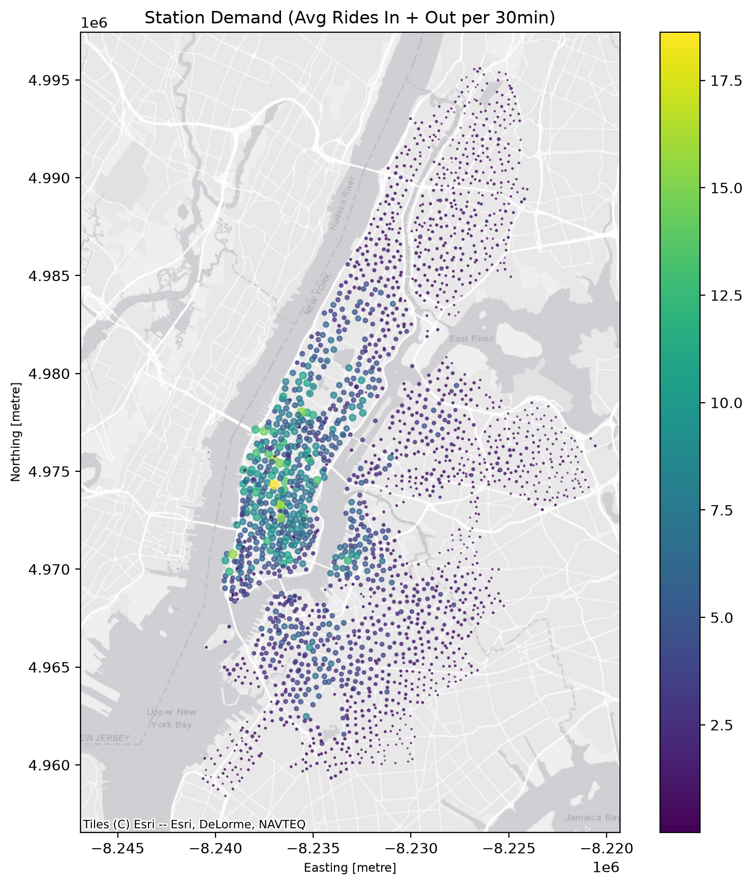
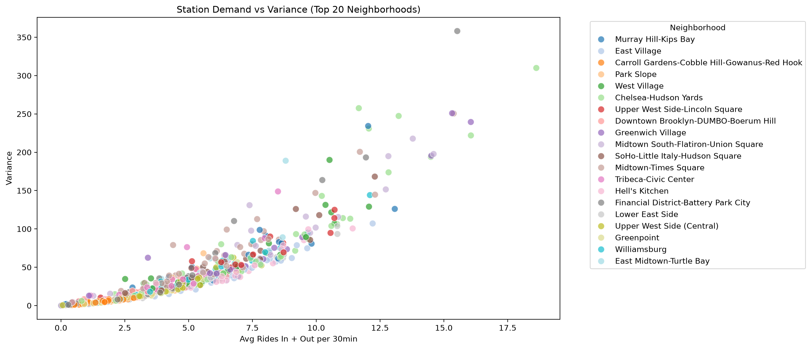
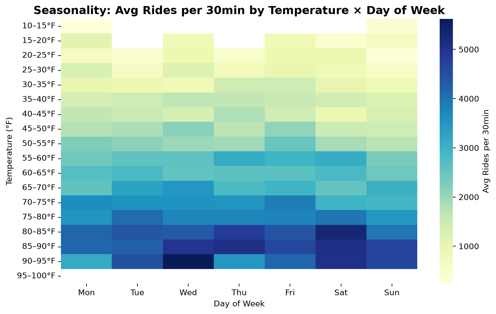
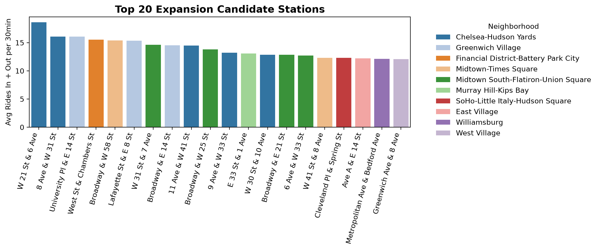

# Citi Bike 2024: Demand Patterns and a Wait-or-Ride-On Decision Model

Two analyses of NYC Citi Bike data from 2024:

| | Notebook | Question |
|---|---|---|
| **Part 1** | [`Final Notebook.ipynb`](Final%20Notebook.ipynb) | Where, when and in what weather do people ride? |
| **Part 2** | [`Decision_model.ipynb`](Decision_model.ipynb) | A rider reaches a full station: should they wait for a dock or ride to a nearby station? ([results](#part-2-wait-or-ride-on-a-decision-model-for-full-stations)) |

Part 1 found that traffic at individual stations swings widely from one 30-minute window to the next (at the busiest station, the standard deviation is about as large as the average). Part 2 asks a narrower question that a simple probability model *can* answer, and tests whether its answers lead to better decisions than simple rules of thumb.

---

# Part 1: Citi Bike Traffic Analysis

## Project Overview
This project analyzes NYC Citi Bike ridership across 2024 to understand how Citi Bike traffic is influenced by various factors.
The goal is to identify clear usage patterns and highlight operational implications for system management.

## Methodology

### Data sources
- Citi Bike trip data (2024)
- Hourly weather for Central Park ([Meteostat](https://meteostat.net))
- NYC Neighborhood Tabulation Areas (NTA) boundaries (`Neighborhood_NTA.geojson`)

### Data cleaning
- Combined all 2024 monthly trip files (44.3 million trips)
- Dropped trips with unparseable timestamps or a missing start or end station, keeping only rides recorded at both ends (44.2 million)
- Checked that every ride id appears only once
- Flagged weekends and US holidays, and added day of week, month and season
- Converted hourly weather from UTC to New York time and joined it to rides in 30-minute windows

### Spatial preparation
- Placed each station at the median of its trip start coordinates
- Spatially joined stations to NTAs (`geopandas.sjoin`); stations that fall outside NYC are Jersey City and Hoboken stations, which have their own Citi Bike data
- Summarized demand at both station level and NTA (neighborhood) level

### Analysis pipeline
1. Count arrivals and departures at each station in 30-minute windows, and net traffic (arrivals − departures)
2. Merge in weather, holiday and calendar features
3. Compute per-station statistics (average, variance, total) and neighborhood and borough summaries
4. Explore:
   - the busiest and quietest stations
   - demand vs. variance by borough and neighborhood
   - the monthly trend, and heatmaps of rides by month, day of week, temperature and precipitation
   - static and interactive station demand maps, and arrivals before a Knicks game at Madison Square Garden compared with other Friday evenings

**Two ways of counting.** Station-level figures count *rides in + out* (each ride counts at both its start and end station). Citywide figures count each ride once.

## Key Insights & Visuals

### 1. Station Demand Map

Hotspots are concentrated in **Midtown and Downtown Manhattan**: 49 of the 50 busiest stations are in Manhattan, and the busiest Brooklyn stations are mostly in **Williamsburg**.
Outer borough stations show lower but more consistent usage. An interactive version is in [`station_demand_map.html`](station_demand_map.html) (download and open in a browser).

---

### 2. Neighborhood Variability

In the 20 busiest neighborhoods, variance rises steeply with demand:
- The busiest stations, almost all in Manhattan, are also the most volatile. At the busiest station, the standard deviation per half hour is about as large as the average.
- Quieter stations are steadier in absolute terms.

Volume and volatility go together.

---

### 3. Weather Effects
- **Temperature**: Ridership rises steadily with temperature and is highest above **80°F**. Warm half-hours are mostly summer daytime, so this partly reflects season and time of day (see below).
- **Precipitation**: At most temperatures, light rain clearly lowers ridership compared with dry weather.



Weather is a strong, immediate driver of demand — making it essential for operational forecasting.


This heatmap shows average citywide rides per 30min by **temperature (°F)** and **precipitation (mm per 30 min)**.
Key patterns:
- In dry weather, ridership climbs steadily from the coldest to the hottest half-hours.
- At the same temperature, half-hours with light rain usually have noticeably fewer rides.
- Heavier rain is rare (each cell is only a handful of half-hours), so those cells are noisy: a few summer storms that hit during busy hours still show high counts.

These heatmaps average over all hours of the day, so they mix weather with time of day and season (hot half-hours are mostly summer afternoons). Part 2 separates them with a regression that holds station, time of day and season fixed: **any rain cuts rides by about 22%, heavy rain by about 55% (3 mm per half hour), and below 35°F rides are about 45% lower than at 65–75°F.**

---

### 4. Seasonality

Monthly rides follow a clear curve (44.2 million rides in 2024):
- **Winter lows** (January–February, about 2 million a month).
- **Spring climb** (March–May).
- **High plateau** from June through October, peaking in **October** (5.1 million).
- **Sharp drop** in November–December.

Demand is highest and steadiest from June through October.

---

## Recommendations

Based on the analysis, Citi Bike could implement:

- **Dynamic rebalancing** → Focus bike movement on the Manhattan hotspots, where 49 of the 50 busiest stations are.
  *The station demand map shows where activity concentrates; that's where rebalancing trucks reach the most riders.*

- **Seasonal planning** → Expand fleet size and staffing from June through October to absorb surges.
  *Ridership stays near its peak for five months, so capacity added for that period serves the most riders.*

- **Weather-aware strategy** → Integrate rain forecasts into redistribution and staffing decisions.
  *Rain cuts demand right away (by about a fifth for any rain, more for heavy rain), so short-term ops adjustments should focus on rainy windows; cold lowers demand too, but it changes slowly with the season.*

- **Expansion opportunities** → Add docks and bikes at the busiest stations: 19 of the top 20 are in Manhattan between Midtown and the Financial District, plus one in Williamsburg.
  
  *Each of these stations averages 12–19 rides in or out every half hour, so extra capacity there serves the most riders.*

- **Consolidation opportunities** → Reevaluate the quietest stations: 7 of the bottom 20 are in the Bronx, and the rest are in East Flatbush and Sunset Park (Brooklyn), Corona and Maspeth (Queens), Inwood, and a second dock at Pier 40 in the West Village.
  
  *Each sees fewer than 5 rides in or out a day; these may warrant consolidation, relocation, or redesign to improve efficiency.*

Both lists rank only the 2,013 NYC stations with rides in every month of 2024. Jersey City and Hoboken stations (which have their own Citi Bike data) and stations that opened, closed or were renamed mid-year would otherwise look artificially quiet. Also left out are 20 stations that never appear as a trip start, so have no recorded location.

---

# Part 2: Wait or ride on? A decision model for full stations

**The situation.** You ride up to your destination station to return a bike and every dock is taken. You can wait for someone to take a bike out (which frees a dock), or ride on to a nearby station and walk back. Which gets you done sooner?

**The approach.** A simple, interpretable probability model plus an explicit decision rule:

1. **Departure rates from trip records.** Each station's rate of bikes leaving = its normal pattern for that half-hour and day type × a citywide weather/season multiplier (Poisson regression). Each departure frees a dock, so P(a dock opens within *w* minutes) = 1 − e^(−expected departures in *w*).
2. **Expected wait** at any station = area under its "still full after *u* minutes" curve.
3. **Decision rule.** Compare staying with the 5 nearest stations within 500 m: ride time + expected wait + walk back. Pick the smallest.
4. **Out-of-sample testing on real full stations.** The model is trained on trip records from days 1–21 of each month and tested on days 22–end, using 2-minute station status snapshots that show when a station was really full and when a dock really opened. A three-parameter recalibration, fitted on days 15–21, corrects for what trip records can't see (competition for freed docks, rebalancing).

**Results.** 59,038 real full-station moments from the test days were replayed through each rule and scored with what actually happened. Each moment is weighted by how many riders typically arrive then.

| Rule | Live data? | Mean minutes | 90th percentile |
|---|---|---|---|
| Always wait | no | 24.0 | 60.0 |
| Always ride to the nearest station | no | 12.6 | 41.7 |
| **Model (recalibrated)** | no | **9.9** | **19.7** |
| Ride to the nearest station showing open docks (app today) | yes | 6.6 | 8.1 |
| Model (trip-based, not recalibrated) + live | yes | 8.0 | 12.9 |
| **Model (recalibrated) + live** | yes | **6.5** | **8.2** |
| Hindsight best (knows the future) | — | 4.8 | 6.7 |


**What it shows.**
- **Without live data**, the model is the best of the rules tested: 21% faster on average than always riding to the nearest station, and it more than halves the bad case.
- **With live data**, the simple app rule already gets riders most of the way, and the model only matches it. Both close about 91% of the gap between always waiting and hindsight. Hindsight does better by sometimes waiting when a dock is about to open (for 22% of riders), which neither rule can spot in advance.
- **Calibration matters for the decision.** Before recalibration, the model said docks would open within 10 minutes 16.7% of the time vs. 13.8% in reality. That small-looking error made its live-data decisions *worse* than the simple rule.

How useful a model is depends on the decision it supports and on what the decision-maker already knows. The method, checks and limitations are documented step by step in [`Decision_model.ipynb`](Decision_model.ipynb).

---

## Repository Contents
```
├── README.md
├── Final Notebook.ipynb              # Part 1: demand analysis
├── Decision_model.ipynb              # Part 2: wait-or-ride-on decision model
├── figures/                          # Part 1 figures
│   └── decision_model/               # Part 2 figures
├── station_demand_map.html           # Part 1 interactive station demand map
├── Neighborhood_NTA.geojson          # NYC neighborhood boundaries (Part 1)
└── requirements.txt
```
Raw data is not stored in the repository (see below).

## How to Run
1. Clone the repo and create an environment (Python 3.10+, tested on 3.13):
   ```bash
   python3 -m venv .venv
   source .venv/bin/activate
   pip install -r requirements.txt
   ```
2. **Trip data:** download the 2024 monthly trip files from [Citi Bike System Data](https://citibikenyc.com/system-data) and unzip them into `data/trips/` (both notebooks read from there).
3. **Station status data (Part 2 only):** the notebook downloads `citi_bike_stations_2024.parquet` (4.2 GB) from the public Kaggle dataset [rosenthal/citi-bike-stations](https://www.kaggle.com/datasets/rosenthal/citi-bike-stations) into `data/status/` on first run (no Kaggle login needed), then builds a smaller cache.
4. Run the notebooks top to bottom. Both load a full year of trips (44 million rides), so they need several GB of RAM; Part 2 keeps this down by loading only the 7 columns it uses. The one-time status cache takes a few minutes.

## Data and Credits
- Trip data: [Citi Bike System Data](https://citibikenyc.com/system-data), used under the Citi Bike data license agreement.
- Station status snapshots: [rosenthal/citi-bike-stations](https://www.kaggle.com/datasets/rosenthal/citi-bike-stations) on Kaggle (CC BY 4.0).
- Weather: [Meteostat](https://meteostat.net) (CC BY-NC 4.0).
- **Python**: pandas, NumPy, matplotlib, seaborn, geopandas, contextily, folium, scikit-learn, SciPy, DuckDB.
