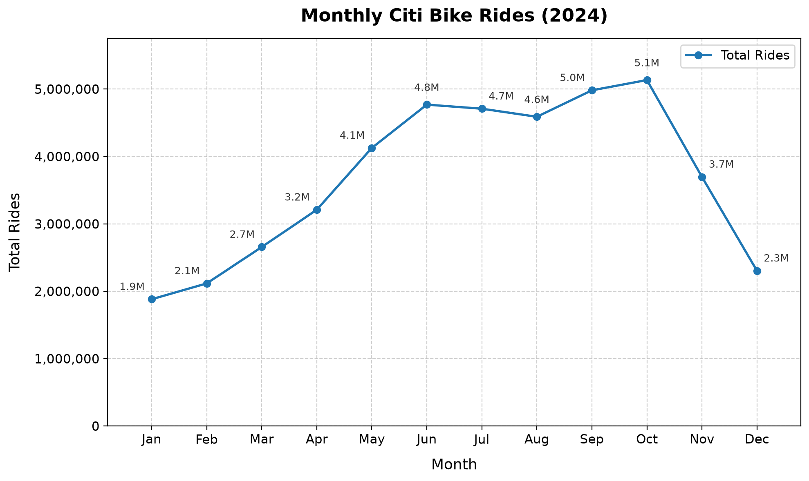
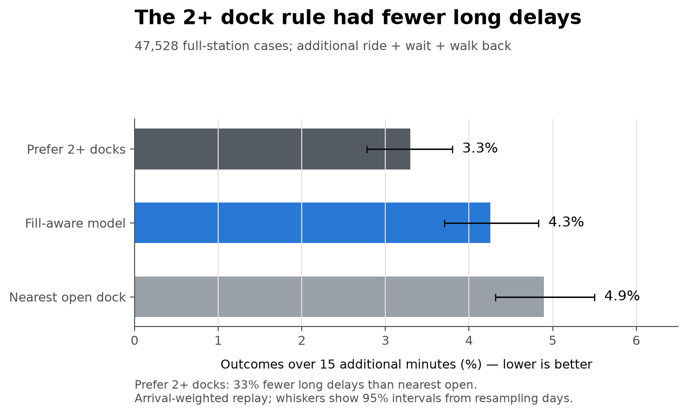
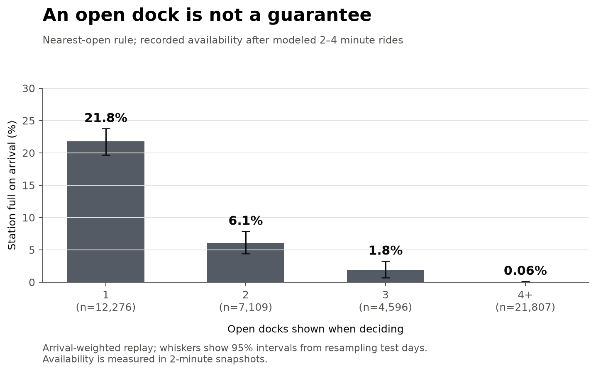
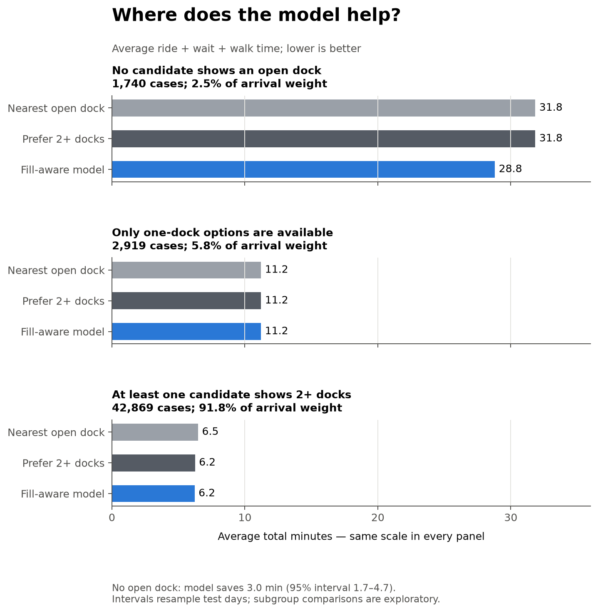

# Citi Bike 2024: Demand Patterns and Return Delays

This project explores 44.2 million NYC Citi Bike trips from 2024, then compares riders' options after reaching a full station.

In the historical replay, preferring a nearby station with **2+ open docks** produced about **one-third fewer delays over 15 minutes** than choosing the nearest station showing any dock. The model helped most when no nearby candidate showed a dock.

- Demand analysis: [Demand_analysis.ipynb](Demand_analysis.ipynb)
- Decision model: [Decision_model.ipynb](Decision_model.ipynb)

## Part 1: Demand patterns

Arrivals and departures were counted in 30-minute windows and joined with Central Park weather, US holidays and NYC neighborhoods. Weather timestamps were converted from UTC to New York time before joining.

- Monthly rides rose from about 2 million in January and February to 5.1 million in October, the peak month.
- Among NYC stations with rides in all 12 months, 49 of the 50 busiest were in Manhattan.
- Ride counts rose with temperature. In Part 2's regression, rain was associated with at least **22% fewer departures** than dry weather, and temperatures below **35°F** with about **45% fewer** than **65–75°F**, accounting for station, time of day and season. Heatmap cells with fewer than 10 half-hours are hidden.
- Arrivals near Madison Square Garden before the Nov 8 Knicks game fell within the range of other Friday evenings.




Station traffic counts rides in + out, so each ride counts at both ends. Citywide charts count each ride once. An [interactive station map](station_demand_map.html) can be opened in a browser.

Part 2 adds station availability to examine return delays: the extra riding, waiting and walking after finding a station full.

## Part 2: Reducing return delays

The replay compares two simple rules with a model that combines Poisson-based waiting times with filling risk measured from status snapshots. All results include **ride + wait + walk back** after reaching the original full station; waiting is capped at 60 minutes.

### Prefer 2+ docks

Choosing the nearest station showing at least two docks reduced outcomes over 15 additional minutes from **4.9% to 3.3%**: about **one-third fewer long delays** than choosing the nearest open station.



The model had the lowest mean, **7.06 minutes versus 7.17** for the 2+ rule, but that difference was small and uncertain, and the 2+ rule had fewer long delays (3.3% versus 4.3%). It accepts one dock if no candidate shows two, and waits if none is open.

### One dock can be gone by arrival

Under the nearest-open rule, a station showing one dock was full after a modeled **2–4 minute ride** in **21.8%** of selected trips. The observed risk was **6.1%** with two docks and **1.8%** with three.



The model accounts for this filling risk. These groups describe the trips selected by the rule; they do not isolate the effect of adding a dock.

### Forecasts help when no candidate shows a dock

Both simple rules then wait at the original station. The model can compare full stations and sometimes ride to one expected to clear sooner.

It averaged **28.8 minutes versus 31.8** for waiting, saving **3.0 minutes** (95% interval 1.7–4.7). This was a small group: **1,740 cases**, or **2.5% of the arrival-weighted replay**.



Candidates are up to five stations within 500 m. The no-open group includes 212 cases with no candidate neighbor. With a 2+ dock option available, the model and the simple rule performed about the same.

In the original comparison without nearby dock counts, the recalibrated model averaged **10.7 minutes versus 12.6** for riding to the nearest station: **1.9 minutes (about 15%) faster**.

### Method and limits

The model estimates departure rates by half-hour and day type, with weather and season adjustments from a Poisson regression. Status snapshots correct the opening probabilities and estimate filling risk. The raw 10-minute opening forecast was **17.4%**, versus **14.4% observed**; recalibration brought it to **14.6%**.

Trips on days 1–21 of each month fit the rates; status data from days 15–21 fits the corrections. Days 22–end are held out from fitting. The replay kept **47,528 of 60,000 sampled moments** with complete follow-up for every candidate. All rules use the same cases, weighted by typical rider arrivals.

- Travel times are approximate; snapshots are 2 minutes apart. Riders do not affect each other or re-check the app during the ride.
- Observed weather substitutes for a forecast. A station already full is assumed to stay full during travel. Completed return trips underrepresent demand at frequently full stations.
- Results cover one year. Newer rules and subgroups are exploratory because test results were inspected during development. Intervals resample days and omit fitted-model and model-selection uncertainty.

These are replay results, not measured savings from a deployed app. The notebook contains the full comparisons and probability checks.

## How to run

1. Create an environment (Python 3.10+, tested on 3.13):
   ```bash
   python3 -m venv .venv
   source .venv/bin/activate
   pip install -r requirements.txt
   ```
2. Download and unzip the 2024 monthly files from [Citi Bike System Data](https://citibikenyc.com/system-data) into `data/trips/`.
3. Run each notebook top to bottom. `Decision_model.ipynb` downloads the public station-status file (4.2 GB) into `data/status/` on its first run. Both notebooks load the year's trips into memory; they were run on a laptop with 16 GB of RAM.

## Data

- Trips: [Citi Bike System Data](https://citibikenyc.com/system-data), under its data license agreement.
- Status snapshots: [rosenthal/citi-bike-stations](https://www.kaggle.com/datasets/rosenthal/citi-bike-stations) (CC BY 4.0).
- Weather: [Meteostat](https://meteostat.net) (CC BY-NC 4.0).
- Neighborhoods: NYC Neighborhood Tabulation Areas (`Neighborhood_NTA.geojson`).
