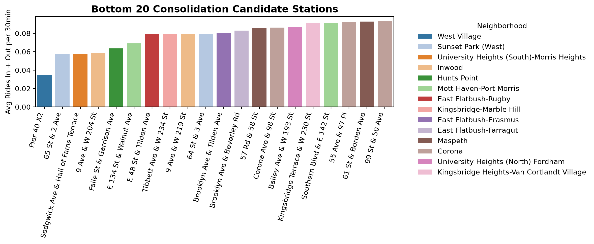

# Citi Bike 2024: Demand Patterns and a Wait-or-Ride-On Decision Model

Two analyses of NYC Citi Bike data from 2024:

| | Notebook | Question |
|---|---|---|
| **Part 1** | [`Final Notebook.ipynb`](Final%20Notebook.ipynb) | Where, when and in what weather do people ride? |
| **Part 2** | [`Decision_model.ipynb`](Decision_model.ipynb) | A rider reaches a full station: should they wait for a dock or ride to a nearby station? ([results](#part-2-wait-or-ride-on-a-decision-model-for-full-stations)) |

Part 1 showed that station traffic in a single 30-minute window is too noisy to forecast reliably. Part 2 asks a narrower question that a simple probability model *can* answer, and tests whether its answers lead to better decisions than simple rules of thumb.

---

# Part 1: Citi Bike Traffic Analysis

## Project Overview
This project analyzes NYC Citi Bike ridership across 2024 to understand how Citi Bike traffic is influenced by various factors.
The goal is to identify clear usage patterns and highlight operational implications for system management.

## Methodology

### Data sources
- Citi Bike trip data (2024)
- Hourly weather for Central Park ([Meteostat](https://meteostat.net))
- NYC Neighborhood Tabulation Areas (NTA) boundaries (`Neighborhood_NTA.geojson`)

### Data cleaning
- Removed trips with missing or implausible times/durations
- Ensured that each ride in the data was only accounted for a single time
- Converted timestamps to **America/New_York** and extracted features (hour, day-of-week, month)
- Incorporated weather data with ridership using nearest hourly timestamps
- Created holiday and weekend indicator variables

> **Known issue:** trip timestamps are New York local time, but Meteostat weather timestamps are UTC, and this notebook joins the two without converting. Weather is therefore matched to rides 4–5 hours late. Part 2 corrects this in its own pipeline; the Part 1 weather figures below have not been regenerated.

### Spatial preparation
- Converted Citi Bike stations to a GeoDataFrame
- Spatially joined stations to NTAs using polygon containment (`geopandas.sjoin`)
- Aggregated demand to both station level and NTA level, enabling neighborhood-scale analysis

### Analysis pipeline
1. Aggregate rides to 30-minute and daily levels
2. Merge in weather and holiday features
3. Aggregate to NTA-level demand time series for stability
4. Generate exploratory analyses:
   - Maps of mean and variance of demand by neighborhood
   - Heatmaps of ridership vs temperature/precipitation
   - Monthly curves to capture seasonal cycles
   - Interactive demand maps
5. Identify geographic hot spots, high-variance neighborhoods, and weather-driven demand dips

## Key Insights & Visuals

### 1. Station Demand Map

Hotspots are concentrated in **Midtown and Downtown Manhattan** as well as parts of **Brooklyn**.
Outer borough stations show lower but more consistent usage. An interactive version is in [`station_demand_map.html`](station_demand_map.html) (download and open in a browser).

---

### 2. Neighborhood Variability

Stations in the top 20 neighborhoods form distinct clusters:
- Midtown/Downtown: **high demand, high variance** (commuter and tourist flows).
- Outer boroughs: **lower demand, lower variance** (consistent neighborhood trips).

This highlights how station type drives both volume and volatility.

---

### 3. Weather Effects
- **Temperature**: Ridership peaks in the **80–90°F range**, boosted by summer tourism and longer daylight.
- **Precipitation**: Even light rain sharply reduces rides, with heavy rain cutting usage to near zero.


Weather is a strong, immediate driver of demand — making it essential for operational forecasting.


This heatmap shows average rides per 30min by **temperature (°F)** and **precipitation (mm)**.
Key patterns:
- Ridership holds up in cool, dry weather.
- Even light rain causes sharp declines.
- Heavy rain almost eliminates demand, regardless of temperature.

Rain is a **bigger suppressor of demand than cold** — critical for forecasting and operations.

---

### 4. Seasonality

Monthly totals follow a clear curve:
- **Winter lows** (January–February).
- **Spring climb** (March–May).
- **Summer peak** (July–August).
- **Fall tapering** (September–November).

This mirrors recreational cycling patterns and highlights capacity stress during summer.

---

## Recommendations

Based on the analysis, Citi Bike could implement:

- **Dynamic rebalancing** → Concentrate bike movement in Midtown and Brooklyn hubs during peak hours.
  *High-demand clusters (see the station demand map above) highlight where rebalancing trucks deliver the most impact — targeting these areas reduces stockouts and idle docks.*

- **Seasonal planning** → Expand fleet size and staffing in the summer months to absorb surges.
  *Summer peaks show the system strains under higher demand; scaling up capacity seasonally ensures smoother rider experience.*

- **Weather-aware strategy** → Integrate rain forecasts into redistribution and staffing decisions.
  *Even light rain suppresses demand more than cold — short-term ops adjustments should focus on rainy windows, not just temperature swings.*

- **Expansion opportunities** → Invest in outer-borough neighborhoods with consistent, moderate demand.
  
  *Low-variance, steadily used stations suggest reliable everyday trips; expanding here steadily grows the user base without volatility.*

- **Consolidation opportunities** → Reevaluate underused or volatile stations that strain resources.
  
  *Stations with persistently low ridership or extreme variability may warrant consolidation, relocation, or redesign to improve efficiency.*

---

# Part 2: Wait or ride on? A decision model for full stations

**The situation.** You ride up to your destination station to return a bike and every dock is taken. You can wait for someone to take a bike out (which frees a dock), or ride on to a nearby station and walk back. Which gets you done sooner?

**The approach.** A simple, interpretable probability model plus an explicit decision rule:

1. **Departure rates from trip records.** Each station's rate of bikes leaving = its normal pattern for that half-hour and day type × a citywide weather/season multiplier (Poisson regression). Each departure frees a dock, so P(a dock opens within *w* minutes) = 1 − e^(−expected departures in *w*).
2. **Expected wait** at any station = area under its "still full after *u* minutes" curve.
3. **Decision rule.** Compare staying with the 5 nearest stations within 500 m: ride time + expected wait + walk back. Pick the smallest.
4. **Out-of-sample testing on real full stations.** The model is trained on trip records from days 1–21 of each month and tested on days 22–end, using 2-minute station status snapshots that show when a station was really full and when a dock really opened. A three-parameter recalibration, fitted on days 15–21, corrects for what trip records can't see (competition for freed docks, rebalancing).

**Results.** 59,038 real full-station moments from the test days were replayed through each rule and scored with what actually happened. Each moment is weighted by how many riders typically arrive then.

| Rule | Live data? | Mean minutes | 90th percentile |
|---|---|---|---|
| Always wait | no | 24.0 | 60.0 |
| Always ride to the nearest station | no | 12.6 | 41.7 |
| **Model (recalibrated)** | no | **9.9** | **19.7** |
| Ride to the nearest station showing open docks (app today) | yes | 6.6 | 8.1 |
| Model (trip-based, not recalibrated) + live | yes | 8.0 | 12.9 |
| **Model (recalibrated) + live** | yes | **6.5** | **8.2** |
| Hindsight best (knows the future) | — | 4.8 | 6.7 |


**What it shows.**
- **Without live data**, the model is the best of the rules tested: 21% faster on average than always riding to the nearest station, and it more than halves the bad case.
- **With live data**, the simple app rule already gets riders most of the way, and the model only matches it. Both close about 91% of the gap between always waiting and hindsight. Hindsight does better by sometimes waiting when a dock is about to open (for 22% of riders), which neither rule can spot in advance.
- **Calibration matters for the decision.** Before recalibration, the model said docks would open within 10 minutes 16.7% of the time vs. 13.8% in reality. That small-looking error made its live-data decisions *worse* than the simple rule.

How useful a model is depends on the decision it supports and on what the decision-maker already knows. The method, checks and limitations are documented step by step in [`Decision_model.ipynb`](Decision_model.ipynb).

---

## Repository Contents
```
├── README.md
├── Final Notebook.ipynb              # Part 1: demand analysis
├── Decision_model.ipynb              # Part 2: wait-or-ride-on decision model
├── figures/                          # Part 1 figures
│   └── decision_model/               # Part 2 figures
├── station_demand_map.html           # Part 1 interactive station demand map
├── Neighborhood_NTA.geojson          # NYC neighborhood boundaries (Part 1)
└── requirements.txt
```
Raw data is not stored in the repository (see below).

## How to Run
1. Clone the repo and create an environment (Python 3.10+, tested on 3.13):
   ```bash
   python3 -m venv .venv
   source .venv/bin/activate
   pip install -r requirements.txt
   ```
2. **Trip data:** download the 2024 monthly trip files from [Citi Bike System Data](https://citibikenyc.com/system-data) and unzip them. `Final Notebook` reads `data/**/*.csv`; `Decision_model` reads the path in `TRIP_DATA_GLOB` (configuration cell), so point it to the same folder.
3. **Station status data (Part 2 only):** the notebook downloads `citi_bike_stations_2024.parquet` (4.2 GB) from the public Kaggle dataset [rosenthal/citi-bike-stations](https://www.kaggle.com/datasets/rosenthal/citi-bike-stations) into `data/status/` on first run (no Kaggle login needed), then builds a smaller cache.
4. Run the notebooks top to bottom. Both load a full year of trips (44 million rides), so they need several GB of RAM; Part 2 keeps this down by loading only the 7 columns it uses. The one-time status cache takes a few minutes.

## Data and Credits
- Trip data: [Citi Bike System Data](https://citibikenyc.com/system-data), used under the Citi Bike data license agreement.
- Station status snapshots: [rosenthal/citi-bike-stations](https://www.kaggle.com/datasets/rosenthal/citi-bike-stations) on Kaggle (CC BY 4.0).
- Weather: [Meteostat](https://meteostat.net) (CC BY-NC 4.0).
- **Python**: pandas, NumPy, matplotlib, seaborn, geopandas, plotly, folium, scikit-learn, SciPy, DuckDB.
